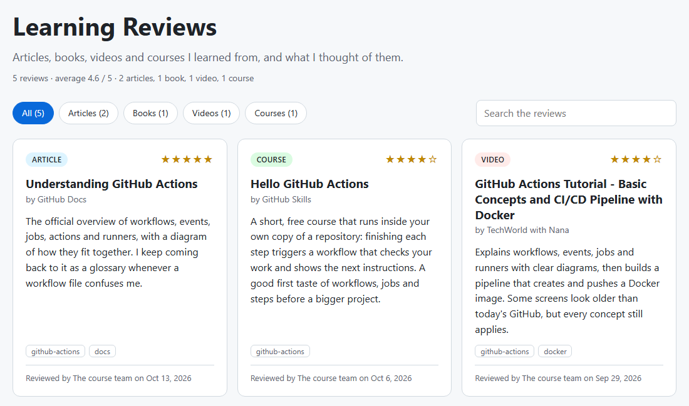
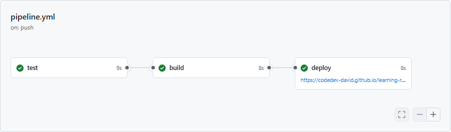
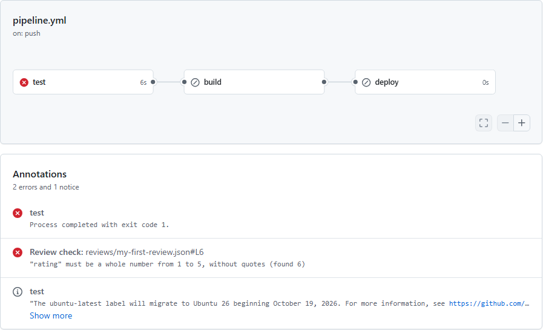
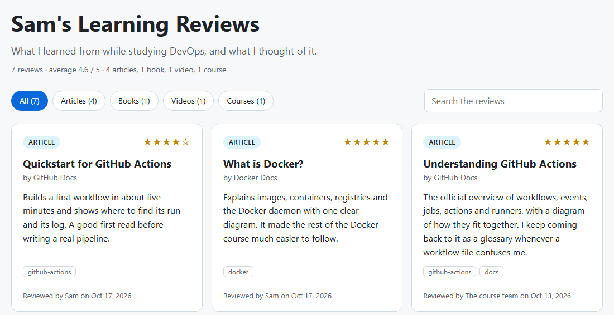

# Project: test, build and deploy a Learning Reviews site with GitHub Actions

Make your own copy of a small website where you review the articles, books, videos and courses you learned from. Then give it a real pipeline, one stage at a time: GitHub Actions tests every change, builds the site and deploys it to GitHub Pages, and a rule on main refuses any change whose checks fail.

- **Time:** About 2 hours 15 minutes, plus 30 minutes for the optional AWS part
- **Where you work:** Git Bash on Windows (Terminal on macOS or Linux), a web browser and a free GitHub account
- **Files used:** The starter repository https://github.com/codedev-david/learning-reviews. Its `tutorial/` folder holds every file you copy in.
- **Matching slides:** GitHub Actions deck: 02 Foundations to 08 Delivery, and 10 Security

## By the end you will

- Create your own repository from a template, and run its checks and unit tests on your computer.
- Build a three-stage pipeline: a **test** job, a **build** job that needs it, and a **deploy** job that publishes your site to GitHub Pages.
- Read a failed run: find the step that failed and the annotation that points at the file and line, then fix it.
- Protect main with a ruleset, so that only a pull request whose checks pass can change the live site.
- Catch a bug in the code with unit tests before it is merged.
- Show the pipeline's status with a badge, and let Dependabot keep the tools up to date.
- Optionally, deploy the same site to Amazon S3 with OpenID Connect, without storing an AWS key anywhere.

## Before you start

- **What you need from the course: only this guide.** There is no zip to download. In step 1 you make your own copy of the starter repository, https://github.com/codedev-david/learning-reviews, and your copy holds every file the guide uses, in its `tutorial/` folder. The same steps are in two places: a PDF on the course portal, and TUTORIAL.md in your copy, where you can copy each command straight from the page. To see where you are heading, look at the finished example's site: https://codedev-david.github.io/learning-reviews-demo/
- A free GitHub account, signed in, with a verified email address.
- Git. On Windows, Git for Windows, which gives you **Git Bash**, as in Lab 1. On macOS or Linux, the Terminal. Git knows your name and email: `git config --global user.name` and `git config --global user.email` each print one line. If one prints nothing, set it, with the email of your GitHub account: `git config --global user.name "Your Name"` and `git config --global user.email "you@example.com"`.
- **Node.js 22 or newer** (the LTS version from https://nodejs.org), for Part B and for checking your reviews before you push. Can't install it? You can still do the project: skip Part B and every `npm` command, and let the pipeline run the same checks for you.
- A code editor for JSON. **Visual Studio Code** is best (free, https://code.visualstudio.com); Notepad works on Windows. On a Mac, don't use TextEdit: it turns straight quotes into curly ones, which breaks JSON.
- Replace **YOUR-USERNAME** with your GitHub username wherever it appears. Every output in this guide comes from a real run of these steps; your commit IDs, run numbers and times will differ.

## The pipeline you will build

- **test**, on every push to main and every pull request: check the review files, lint the code, run the unit tests.
- **build**, only after test passes: build the site with the same command you run on your computer, and keep it.
- **deploy**, only after build, and only for main: publish the site to GitHub Pages.
- **A ruleset on main**: no change gets in without a pull request whose **test** and **build** checks pass.

## Contents

- [Part A — Get your own copy](#part-a--get-your-own-copy) (3 steps)
- [Part B — Run it on your computer](#part-b--run-it-on-your-computer) (5 steps)
- [Part C — Stage 1: test every change](#part-c--stage-1-test-every-change) (5 steps)
- [Part D — Stage 2: build the site](#part-d--stage-2-build-the-site) (4 steps)
- [Part E — Stage 3: deploy to GitHub Pages](#part-e--stage-3-deploy-to-github-pages) (5 steps)
- [Part F — Your first review, and a mistake the pipeline catches](#part-f--your-first-review-and-a-mistake-the-pipeline-catches) (6 steps)
- [Part G — Protect main: every change through a pull request](#part-g--protect-main-every-change-through-a-pull-request) (14 steps)
- [Part H — A bug in the code: the unit tests catch it](#part-h--a-bug-in-the-code-the-unit-tests-catch-it) (6 steps)
- [Part I — Show the status, and keep the tools up to date](#part-i--show-the-status-and-keep-the-tools-up-to-date) (5 steps)
- [Part J — Optional: a copy on Amazon S3](#part-j--optional-a-copy-on-amazon-s3) (9 steps)
- [Challenge — add a new review type: talk](#challenge--add-a-new-review-type-talk)
- [Clean up](#clean-up)
- [Check your work](#check-your-work)
- [Troubleshooting reference](#troubleshooting-reference)

## Part A — Get your own copy

*Make your own repository from the starter project, and copy it to your computer.*

### Step 1. Create your repository from the template (3 min)

**Why:** A template gives you your own repository with all the starter code, owned by you and tied to nothing else.

In your browser, open https://github.com/codedev-david/learning-reviews and sign in to GitHub if it asks. Click the green **Use this template** button, then **Create a new repository**. On the form:

- **Owner:** you.
- **Repository name:** `learning-reviews`
- Choose **Public**: GitHub Pages is free only for public repositories.
- Leave **Include all branches** cleared.

Click **Create repository**.

> [!TIP]
> **Checkpoint:** Your new repository's page shows **YOUR-USERNAME/learning-reviews**, with **generated from codedev-david/learning-reviews** under its name.

> [!NOTE]
> Why a template and not a fork? A fork stays tied to the original repository: on a fork, a new pull request is opened against codedev-david/learning-reviews unless you change it, so your practice pull requests would land in the instructor's repository. A repository made from a template is yours alone.

### Step 2. Copy the repository to your computer (3 min)

Open **Git Bash** (on macOS or Linux, the Terminal). In the second line, replace YOUR-USERNAME with your GitHub username, then run:

Run in `~` (your home folder), in Git Bash:

```bash
cd ~
git clone https://github.com/YOUR-USERNAME/learning-reviews.git
cd learning-reviews
ls
```

You should see (trimmed):

```text
Cloning into 'learning-reviews'...
…
README.md  TUTORIAL.md  eslint.config.js  package-lock.json  package.json  public/  reviews/  scripts/  site.json  src/  test/  tutorial/
```

`git clone` copies the repository, with its history, into a new folder, learning-reviews. Every command from now on runs in that folder.

> [!TIP]
> **Checkpoint:** Git Bash shows `~/learning-reviews (main)` above the prompt.

### Step 3. Look around the project (4 min)

Run in `~/learning-reviews`, in Git Bash:

```bash
git log --oneline
```

You should see:

```text
a12776e Initial commit
```

A repository made from a template starts with one commit, **Initial commit**, that holds all the starter files:

- `reviews/`: one JSON file per review. This is the folder you add to.
- `site.json`: the site's title and tagline.
- `src/`: the code. `reviews.js` checks every review against the rules, `render.js` turns reviews into HTML, `build.js` writes the finished site into `dist/`, and `check.js` reports problems.
- `test/`: the unit tests for that code.
- `public/`: the stylesheet, and a small script that filters and searches the reviews.
- `scripts/serve.js`: a tiny web server, to look at the site on your computer.
- `tutorial/`: the files this guide asks you to copy in. You never type a workflow: each one comes from here.

There is no `.github/workflows` folder yet, so the repository has no pipeline. You build it in Parts C to E.

## Part B — Run it on your computer

*Install the project's tools, run its checks and tests, and look at the site before any pipeline exists.*

Part B needs Node.js. If you can't install it, read this part without running it, skip every `npm run check` later on, and let the pipeline run the checks for you.

### Step 4. Check that Node.js is installed (1 min)

Run in `~/learning-reviews`, in Git Bash:

```bash
node --version
npm --version
```

You should see:

```text
v24.21.0
11.19.0
```

Any Node.js from version 22 on works; the pipeline uses 24.

| If you see | Do this |
| --- | --- |
| `bash: node: command not found` | Install the LTS version from https://nodejs.org with the installer's defaults. Then close Git Bash, open it again and run `cd ~/learning-reviews`. |

### Step 5. Install the project's tools (2 min)

Run in `~/learning-reviews`, in Git Bash:

```bash
npm ci
```

You should see:

```text
added 79 packages, and audited 80 packages in 4s

18 packages are looking for funding
  run `npm fund` for details

found 0 vulnerabilities
```

`npm ci` installs exactly the versions listed in `package-lock.json` into `node_modules/`: ESLint, which checks the code. The site itself needs nothing but Node.js, which is why the pipeline's build job will skip this step.

### Step 6. Check the reviews and the code (2 min)

Run in `~/learning-reviews`, in Git Bash:

```bash
npm run check
npm run lint
```

You should see:

```text
> learning-reviews@1.0.0 check
> node src/check.js

✓ site.json and 5 review files follow the rules.

> learning-reviews@1.0.0 lint
> eslint .
```

`npm run check` reads `site.json` and every file in `reviews/`, and checks each one against the rules: a known type, a rating from 1 to 5, a full https link, a real date, and so on. `npm run lint` runs ESLint over the JavaScript. It prints nothing when it finds nothing.

### Step 7. Run the unit tests (2 min)

Run in `~/learning-reviews`, in Git Bash:

```bash
npm test
```

You should see (trimmed):

```text
> learning-reviews@1.0.0 test
> node --test --test-reporter=spec

▶ build
  ✔ writes the page, the data file and the assets into dist/ (44.2253ms)
  ✔ refuses to build when a review breaks a rule (8.6755ms)
  ✔ summarises the build for the run page on GitHub (0.3993ms)
✔ build (54.3415ms)
▶ report
  ✔ prints one line per problem on your computer (0.9477ms)
…
ℹ tests 39
ℹ suites 9
ℹ pass 39
ℹ fail 0
```

Node.js's built-in test runner runs the files in `test/`. Each ✔ is a test that passed, and `fail 0` means none failed. These tests check the code itself: that stars are drawn right, that a review can't inject HTML into the page, that every rule catches what it should.

### Step 8. Build the site and look at it (4 min)

Run in `~/learning-reviews`, in Git Bash:

```bash
npm start
```

You should see:

```text
> learning-reviews@1.0.0 start
> node src/build.js && node scripts/serve.js

✓ Built 5 reviews into dist/: index.html, reviews.json, app.js, style.css
Serving dist/ at http://localhost:4000 (press Ctrl+C to stop)
```

Open http://localhost:4000 in your browser. Click the filter buttons, and type docker in the search box. Then go back to Git Bash and press **Ctrl+C** to stop the server.



*The starter site on your computer: five reviews, filters and a search box.*

> [!TIP]
> **Checkpoint:** The page lists 5 reviews, **Articles (2)** shows two of them, and the footer says **Built on your computer**.

## Part C — Stage 1: test every change

*Add the pipeline's first job: on every push and every pull request, it checks the reviews, lints the code and runs the unit tests.*

### Step 9. Read the first stage of the pipeline (4 min)

File `tutorial/pipeline-1-test.yml`:

```yaml
# Tutorial stage 1: test every change.
# Copy it into place with:  cp tutorial/pipeline-1-test.yml .github/workflows/pipeline.yml
name: Pipeline

# When it runs: a push to main, every pull request, and the "Run workflow" button.
on:
  push:
    branches: [main]
  pull_request:
  workflow_dispatch:

# The token GitHub gives these jobs can only read the code.
permissions:
  contents: read

jobs:
  test:
    runs-on: ubuntu-latest
    steps:
      - name: Get the code
        uses: actions/checkout@v7

      - name: Set up Node.js
        uses: actions/setup-node@v7
        with:
          node-version: 24
          cache: npm

      - name: Install the tools
        run: npm ci

      - name: Check the review files
        run: npm run check

      - name: Lint the code
        run: npm run lint

      - name: Run the unit tests
        run: npm test
```

- `on:` says when the pipeline runs: a push to `main`, any pull request, and a **Run workflow** button (`workflow_dispatch`).
- `permissions: contents: read`: the token GitHub gives the job can read the code, and nothing else.
- `jobs:` holds one job, `test`, which runs on a fresh Ubuntu machine from GitHub (`runs-on: ubuntu-latest`).
- `actions/checkout` copies your repository onto that machine. `actions/setup-node` installs Node.js 24, and `cache: npm` keeps npm's downloads so that later runs install faster.
- The last four steps are the commands you ran in Part B. If one fails, the job stops there and fails.

### Step 10. Put it in place and push (3 min)

Run in `~/learning-reviews`, in Git Bash:

```bash
mkdir -p .github/workflows
cp tutorial/pipeline-1-test.yml .github/workflows/pipeline.yml
git add .github/workflows/pipeline.yml
git commit -m "Add the test stage of the pipeline"
git push
```

You should see (trimmed):

```text
[main a402330] Add the test stage of the pipeline
 1 file changed, 39 insertions(+)
 create mode 100644 .github/workflows/pipeline.yml
To https://github.com/YOUR-USERNAME/learning-reviews.git
   a12776e..a402330  main -> main
```

GitHub runs every workflow file it finds in `.github/workflows/`. The file's name is up to you; the Actions tab shows the `name:` inside it, **Pipeline**.

> [!NOTE]
> The first time you push, Git Credential Manager opens a window, **Connect to GitHub**. Click **Sign in with your browser**, sign in if GitHub asks, and if it asks you to authorize Git Credential Manager, click the green button that starts with **Authorize**. When the browser shows **Authentication Succeeded**, go back to Git Bash. Later pushes don't ask again.
>
> That browser sign-in also gives Git the `workflow` permission. Without it, GitHub refuses any push that adds or changes a file in `.github/workflows`.
>
> On macOS or Linux, Git asks for a username and a password instead, and GitHub refuses your account's password there. Either install Git Credential Manager (on a Mac: `brew install --cask git-credential-manager`) and push again, to sign in with your browser as above; or make a token: on GitHub, click your picture, **Settings**, **Developer settings**, **Personal access tokens**, **Tokens (classic)**, then **Generate new token (classic)**. Select the **repo** and **workflow** scopes, click **Generate token**, and paste the token when Git asks for your password.

### Step 11. Watch the pipeline run (3 min)

In your browser, open your repository and click the **Actions** tab. A run named **Add the test stage of the pipeline**, your commit message, appears within a few seconds. Click it, then click the **test** job. You see its steps; click any step to open its log.

The test job's steps:

```text
✓ Set up job
✓ Get the code
✓ Set up Node.js
✓ Install the tools
✓ Check the review files
✓ Lint the code
✓ Run the unit tests
✓ Post Set up Node.js
✓ Post Get the code
✓ Complete job
```

**Set up job**, the **Post** steps and **Complete job** are GitHub's own; the others are the steps in your file, by their `name:`.

> [!NOTE]
> Until GitHub has moved `ubuntu-latest` to Ubuntu 26.04, each job may show a notice: **The ubuntu-latest label will migrate to Ubuntu 26 beginning October 19, 2026**. It's information, not an error: this project was tested on both Ubuntu 24.04 and 26.04.

### Step 12. Read the unit tests' log (2 min)

Click the step **Run the unit tests**. Its last lines are the summary you saw on your computer:

The end of the log (trimmed):

```text
ℹ tests 39
ℹ suites 9
ℹ pass 39
ℹ fail 0
```

> [!TIP]
> **Checkpoint:** The run has a green ✓ on the Actions tab.

### Step 13. Run it by hand (2 min)

On the **Actions** tab, in the left sidebar, click **Pipeline**. Above the list of runs, click **Run workflow**, leave **Branch: main** as it is, and click the green **Run workflow** button.

`workflow_dispatch` in the `on:` list is what adds this button. Use it to check main again at any time.

> [!TIP]
> **Checkpoint:** A new run named **Pipeline** appears and turns green. Runs started with the button are named after the workflow, not after a commit.

## Part D — Stage 2: build the site

*Add a build job that runs only when the tests pass, and keep the finished site as an artifact you can download.*

### Step 14. Copy the second stage and see what changed (3 min)

Run in `~/learning-reviews`, in Git Bash:

```bash
cp tutorial/pipeline-2-build.yml .github/workflows/pipeline.yml
git diff
```

You should see (the end of the output):

```text
…
+  build:
+    # Starts only after the test job has passed.
+    needs: test
+    runs-on: ubuntu-latest
+    steps:
+      - name: Get the code
+        uses: actions/checkout@v7
+
+      - name: Set up Node.js
+        uses: actions/setup-node@v7
+        with:
+          node-version: 24
+
+      - name: Build the site
+        run: npm run build
+
+      - name: Save the site as an artifact
+        uses: actions/upload-artifact@v7
+        with:
+          name: site
+          path: dist
```

- `needs: test` makes build wait for test, and skips build if test fails.
- The build job starts on a new, empty machine. Jobs share nothing, so it checks out the code again.
- It doesn't run `npm ci`: building the site needs only Node.js.
- `actions/upload-artifact` keeps the finished `dist/` folder as an artifact named **site**.

> [!NOTE]
> If the output fills the window and ends with `:`, Git is showing it page by page: press **q** to get back to the prompt.

### Step 15. Commit and push (1 min)

Run in `~/learning-reviews`, in Git Bash:

```bash
git commit -am "Build the site in the pipeline"
git push
```

You should see (trimmed):

```text
[main c4ff321] Build the site in the pipeline
 1 file changed, 24 insertions(+), 2 deletions(-)
To https://github.com/YOUR-USERNAME/learning-reviews.git
   a402330..c4ff321  main -> main
```

`-a` commits every file Git already tracks, here the changed `pipeline.yml`, without a separate `git add`.

### Step 16. Watch test, then build (3 min)

On the **Actions** tab, open the run **Build the site in the pipeline**. The graph shows **test**, then an arrow to **build**: build starts only when test has passed. When both are green, scroll down the run's page.

The build summary, under the graph:

```text
Site built: 5 reviews, average rating 4.6 / 5

Type      Reviews
article   2
book      1
video     1
course    1
```

`src/build.js` writes this summary into a file that GitHub gives every step (`$GITHUB_STEP_SUMMARY`), and GitHub shows it on the run's page. Below it, **Artifacts** lists **site**, about 5 KB.

### Step 17. Download the site the pipeline built (3 min)

Under **Artifacts**, click **site**. Your browser downloads site.zip. Extract it (in File Explorer: right-click it, **Extract All**, **Extract**; on a Mac, double-click it) and open index.html from the extracted folder. Its files and its footer:

The files, and the footer's text:

```text
app.js
index.html
reviews.json
style.css
Built by GitHub Actions run #3 from commit c4ff321 on 2026-10-18 03:00 UTC · Source code
```

> [!TIP]
> **Checkpoint:** The footer names the run and the commit that built the site: your own run number and commit ID.

## Part E — Stage 3: deploy to GitHub Pages

*Turn on GitHub Pages, add a deploy job that publishes main, and open your site on the internet.*

### Step 18. Turn on GitHub Pages (2 min)

On GitHub, in your repository, click **Settings**. In the "Code, planning, and automation" section of the sidebar, click **Pages**. Under "Build and deployment", under "Source", select **GitHub Actions**. GitHub suggests some workflow templates: skip them, because your pipeline already builds the site.

> [!TIP]
> **Checkpoint:** In the Settings sidebar, click **Environments**: an environment named **github-pages** is there. GitHub created it when you chose the source, and only main may deploy to it.

> [!NOTE]
> Do this step before you push stage 3. If the deploy job runs while Pages is off, it fails with **Failed to create deployment (status: 404)** and **Ensure GitHub Pages has been enabled**. To recover, do this step, open the failed run, click **Re-run jobs**, then **Re-run failed jobs**.

### Step 19. Read the deploy stage (4 min)

File `tutorial/pipeline-3-deploy.yml` (the parts that are new):

```yaml
      - name: Package the site for GitHub Pages
        uses: actions/upload-pages-artifact@v5
        with:
          path: dist

  deploy:
    # Starts only after the build job has passed, and only for main:
    # a pull request is tested and built, but never published.
    needs: build
    if: github.ref == 'refs/heads/main'
    runs-on: ubuntu-latest
    # This job, and only this job, may publish to GitHub Pages.
    permissions:
      pages: write
      id-token: write
    environment:
      name: github-pages
      url: ${{ steps.deployment.outputs.page_url }}
    # One deployment at a time; a newer one waits instead of cancelling one that is half done.
    concurrency:
      group: pages
      cancel-in-progress: false
    steps:
      - name: Publish the site
        id: deployment
        uses: actions/deploy-pages@v5
```

- The build job's last step now packs `dist/` with `actions/upload-pages-artifact`, in the form GitHub Pages expects.
- `needs: build` and `if: github.ref == 'refs/heads/main'`: deploy runs after build, and only for main. A pull request is tested and built, but never published.
- `permissions`: only this job may publish (`pages: write`). `id-token: write` lets it prove to GitHub Pages which repository and run it comes from.
- `environment: github-pages` records each deployment, and puts your site's address on the run's graph.
- `concurrency` with `cancel-in-progress: false`: if two pushes come close together, the second deployment waits for the first instead of cancelling it halfway.

### Step 20. Copy it, commit and push (2 min)

Run in `~/learning-reviews`, in Git Bash:

```bash
cp tutorial/pipeline-3-deploy.yml .github/workflows/pipeline.yml
git commit -am "Deploy the site to GitHub Pages"
git push
```

You should see (trimmed):

```text
[main e7a5db6] Deploy the site to GitHub Pages
 1 file changed, 26 insertions(+), 5 deletions(-)
To https://github.com/YOUR-USERNAME/learning-reviews.git
   c4ff321..e7a5db6  main -> main
```

### Step 21. Watch the deploy, then open your site (3 min)

On the **Actions** tab, open the run **Deploy the site to GitHub Pages**. The graph now has three jobs: **test**, **build** and **deploy**. When deploy is green, its box shows your site's address. Click it.



*A green run of the finished pipeline. The address under deploy is your site.*

> [!TIP]
> **Checkpoint:** Your site opens at https://YOUR-USERNAME.github.io/learning-reviews/ and its footer says which run and commit built it.

> [!NOTE]
> The address is always lowercase, even if your username has capitals. A brand-new site can take a minute to appear: if you get a 404 page, wait and reload.

### Step 22. Make the site yours (4 min)

Open `site.json` in your editor (in VS Code: `code site.json`), change the title and the tagline, keep the double quotes, and save. Sam's:

File `site.json`:

```json
{
  "title": "Sam's Learning Reviews",
  "tagline": "What I learned from while studying DevOps, and what I thought of it."
}
```

Run in `~/learning-reviews`, in Git Bash:

```bash
npm run check
git commit -am "Make the site mine"
git push
```

You should see (trimmed):

```text
> learning-reviews@1.0.0 check
> node src/check.js
✓ site.json and 5 review files follow the rules.
[main 7d8c7bd] Make the site mine
 1 file changed, 2 insertions(+), 2 deletions(-)
To https://github.com/YOUR-USERNAME/learning-reviews.git
   e7a5db6..7d8c7bd  main -> main
```

> [!TIP]
> **Checkpoint:** When the run is green, about 40 seconds later, reload your site with **Ctrl+F5**: it shows your title.

> [!NOTE]
> GitHub Pages lets browsers keep a page for up to 10 minutes. Ctrl+F5 (Cmd+Shift+R on a Mac) asks for a fresh copy; a normal reload may still show the old version for a while.

## Part F — Your first review, and a mistake the pipeline catches

*Review something you learned from, and see the pipeline stop a mistake before it reaches your site.*

### Step 23. Copy the review template (1 min)

Run in `~/learning-reviews`, in Git Bash:

```bash
cp tutorial/new-review.json reviews/my-first-review.json
code reviews/my-first-review.json
```

> [!TIP]
> **Checkpoint:** The new file opens in your editor, full of example values.

> [!NOTE]
> `code` opens a file in VS Code. On a Mac, it works once you open VS Code, press Cmd+Shift+P and run **Shell Command: Install 'code' command in PATH**. No VS Code? On Windows, use `notepad reviews/my-first-review.json`; on a Mac or Linux, `nano reviews/my-first-review.json` (save with Ctrl+O and Enter, quit with Ctrl+X). Use the same editor wherever this guide says `code`. A review's file name may use only lowercase letters, numbers and hyphens.

### Step 24. Write your review, with one mistake on purpose (6 min)

Pick something you really learned from: an article (a Medium post counts as an article), a book, a YouTube video, a course or a podcast. Replace every value:

- `title`: its title.
- `type`: one of `article`, `book`, `video`, `course` or `podcast`.
- `url`: its full link, starting with `https://`.
- `creator`: the author, channel, teacher or host.
- `rating`: type **6**, on purpose. The rules allow 1 to 5; you will fix it in step 28.
- `reviewer`: your name.
- `date`: today, written as YYYY-MM-DD.
- `review`: two or three sentences: what it taught you, and who should read or watch it.
- `tags`: up to five, lowercase, like `["docker", "ci-cd"]`, or keep `["github-actions"]`.

Keep every double quote and every comma: the file must stay valid JSON. Numbers, like the rating, have no quotes. Save the file. Sam's file is below; on the page, a long line wraps with an indent, but in your file each field stays on one line.

File `reviews/my-first-review.json`:

```json
{
  "title": "Quickstart for GitHub Actions",
  "type": "article",
  "url": "https://docs.github.com/en/actions/get-started/quickstart",
  "creator": "GitHub Docs",
  "rating": 6,
  "reviewer": "Sam",
  "date": "2026-10-17",
  "review": "Builds a first workflow in about five minutes and shows where to find its run and its log. A good first read before writing a real pipeline.",
  "tags": ["github-actions"]
}
```

### Step 25. Check it (1 min)

Run in `~/learning-reviews`, in Git Bash:

```bash
npm run check
```

You should see:

```text
> learning-reviews@1.0.0 check
> node src/check.js

✗ reviews/my-first-review.json (line 6): "rating" must be a whole number from 1 to 5, without quotes (found 6)

1 problem(s) found. Fix them, then run npm run check again.
```

The check names the file, the line and the problem. The rating is on line 6, because your file has the same layout as the template.

### Step 26. Push it anyway (1 min)

Imagine you forgot to run the check. Push the review:

Run in `~/learning-reviews`, in Git Bash:

```bash
git add reviews/my-first-review.json
git commit -m "Add my first review"
git push
```

You should see (trimmed):

```text
[main 9a46126] Add my first review
 1 file changed, 11 insertions(+)
 create mode 100644 reviews/my-first-review.json
To https://github.com/YOUR-USERNAME/learning-reviews.git
   7d8c7bd..9a46126  main -> main
```

### Step 27. Read the failed run (4 min)

On the **Actions** tab, the run **Add my first review** has a red ✗. Open it. In the graph, **test** failed and **build** and **deploy** were skipped. Under the graph, the **Annotations** box points at your file and its line: **Review check**, reviews/my-first-review.json#L6. Click the **test** job, then the failed step **Check the review files**:



*The failed run. The annotation names the file, the line and the problem.*

The failed step's log:

```text
> learning-reviews@1.0.0 check
> node src/check.js

✗ reviews/my-first-review.json (line 6): "rating" must be a whole number from 1 to 5, without quotes (found 6)
Error: "rating" must be a whole number from 1 to 5, without quotes (found 6)

1 problem(s) found. Fix them, then run npm run check again.
Error: Process completed with exit code 1.
```

`npm run check` printed one extra line for GitHub, starting with `::error file=...`. GitHub turns such lines into annotations, which is how the run page can point at line 6 of your file. Because the check failed, the lint and unit test steps never ran.

> [!TIP]
> **Checkpoint:** Reload your site with Ctrl+F5: it still shows the reviews it had before, without yours. A failed run never reaches the live site.

### Step 28. Fix it and push (3 min)

In your editor, change the rating to a whole number from 1 to 5, and save. Then:

Run in `~/learning-reviews`, in Git Bash:

```bash
npm run check
git commit -am "Fix the rating in my first review"
git push
```

You should see (trimmed):

```text
> learning-reviews@1.0.0 check
> node src/check.js
✓ site.json and 6 review files follow the rules.
[main 40f86ac] Fix the rating in my first review
 1 file changed, 1 insertion(+), 1 deletion(-)
To https://github.com/YOUR-USERNAME/learning-reviews.git
   9a46126..40f86ac  main -> main
```

> [!TIP]
> **Checkpoint:** The run is green, all three jobs. After a Ctrl+F5, your site shows your review, and 6 reviews in all.

## Part G — Protect main: every change through a pull request

*Make main accept changes only through a pull request whose checks pass, then use that flow: branch, push, pull request, merge.*

### Step 29. Open the rulesets (1 min)

On GitHub, in your repository, click **Settings**. In the left sidebar, under "Code, planning, and automation", click **Rules**, then **Rulesets**. If your sidebar shows **Rulesets** instead of Rules, click it.

> [!TIP]
> **Checkpoint:** The page shows **Rulesets** and a **New ruleset** button.

### Step 30. Start a ruleset for main (2 min)

Click **New ruleset**, then **New branch ruleset**.

- Under **Ruleset name**, type `Protect main`.
- To change the enforcement status, click **Disabled** and select **Active**.
- Under **Target branches**, click **Add a target**, then **Include default branch**. The ruleset now covers main.

> [!TIP]
> **Checkpoint:** The ruleset is named Protect main, is Active, and targets the default branch.

### Step 31. Choose the rules, and create the ruleset (4 min)

Under **Branch protections**, **Restrict deletions** and **Block force pushes** are already selected: leave them. Then:

- Select **Require a pull request before merging**. Leave **Required approvals** at 0: you work alone, and GitHub never lets you approve your own pull request.
- Select **Require status checks to pass before merging**. In its **Additional settings**, type `test` and click **+**; then type `build` and click **+**. Make sure **Require branches to be up to date before merging** is cleared.

At the bottom of the page, click **Create**. If GitHub asks you to confirm access, confirm with your password, a passkey or a 2FA code.

Why both **test** and **build**? When test fails, build is skipped, and GitHub counts a skipped check as passed. With only build required, a pull request whose tests fail could still be merged. Requiring test closes that gap.

> [!TIP]
> **Checkpoint:** The ruleset is listed as **Active**.

### Step 32. Prove that main is protected (2 min)

Run in `~/learning-reviews`, in Git Bash:

```bash
git commit --allow-empty -m "Try to push straight to main"
git push
```

You should see (trimmed):

```text
[main 62cb753] Try to push straight to main
remote: error: GH013: Repository rule violations found for refs/heads/main.
remote: Review all repository rules at https://github.com/YOUR-USERNAME/learning-reviews/rules?ref=refs%2Fheads%2Fmain
remote:
remote: - Changes must be made through a pull request.
remote:
remote: - 2 of 2 required status checks are expected.
remote:
To https://github.com/YOUR-USERNAME/learning-reviews.git
 ! [remote rejected] main -> main (push declined due to repository rule violations)
error: failed to push some refs to 'https://github.com/YOUR-USERNAME/learning-reviews.git'
```

The ruleset refused the push: main now changes only through pull requests, even for you, the owner. `--allow-empty` made a commit with no changes, just for this test.

### Step 33. Undo the test commit (1 min)

Run in `~/learning-reviews`, in Git Bash:

```bash
git reset --hard origin/main
```

You should see:

```text
HEAD is now at 40f86ac Fix the rating in my first review
```

`origin/main` is your copy of GitHub's main. This moves your local main back to it, dropping the empty commit. Use `reset --hard` with care: it also throws away changes you haven't committed.

### Step 34. Start a branch for your second review (1 min)

Run in `~/learning-reviews`, in Git Bash:

```bash
git switch -c second-review
```

You should see:

```text
Switched to a new branch 'second-review'
```

A branch is your own line of work. Main stays as it is until a pull request merges your branch into it.

### Step 35. Copy the template for your second review (1 min)

Run in `~/learning-reviews`, in Git Bash:

```bash
cp tutorial/new-review.json reviews/second-review.json
code reviews/second-review.json
```

> [!TIP]
> **Checkpoint:** The new file opens in your editor.

### Step 36. Write your second review, with a mistake (4 min)

Review something else you learned from, but this time set `"type": "blog"`, on purpose: blog isn't one of the allowed types. Don't run the check: let the pull request catch it. Save the file. Sam's:

File `reviews/second-review.json`:

```json
{
  "title": "What is Docker?",
  "type": "blog",
  "url": "https://docs.docker.com/get-started/docker-overview/",
  "creator": "Docker Docs",
  "rating": 5,
  "reviewer": "Sam",
  "date": "2026-10-17",
  "review": "Explains images, containers, registries and the Docker daemon with one clear diagram. It made the rest of the Docker course much easier to follow.",
  "tags": ["docker"]
}
```

> [!TIP]
> **Checkpoint:** Your second review is saved, with `"type": "blog"`.

### Step 37. Commit and push the branch (2 min)

Run in `~/learning-reviews`, in Git Bash:

```bash
git add reviews/second-review.json
git commit -m "Add a second review"
git push -u origin second-review
```

You should see (trimmed):

```text
[second-review b95ae25] Add a second review
 1 file changed, 11 insertions(+)
 create mode 100644 reviews/second-review.json
remote:
remote: Create a pull request for 'second-review' on GitHub by visiting:
remote:      https://github.com/YOUR-USERNAME/learning-reviews/pull/new/second-review
remote:
To https://github.com/YOUR-USERNAME/learning-reviews.git
 * [new branch]      second-review -> second-review
branch 'second-review' set up to track 'origin/second-review'.
```

`-u origin second-review` creates the branch on GitHub and links your local branch to it, so later pushes from this branch need only `git push`.

### Step 38. Open a pull request (2 min)

On your repository's **Code** tab, in the yellow banner, click **Compare & pull request**. Check that **base** is `main` and **compare** is `second-review`. Keep the title **Add a second review** and click **Create pull request**.

> [!TIP]
> **Checkpoint:** The pull request is open, as #1, and its checks start within a few seconds.

### Step 39. See the merge blocked (3 min)

Stay on the pull request's **Conversation** tab. Within a minute, the checks at the bottom show **test** failed, with **build** and **deploy** skipped, and a banner says **Merging is blocked**. Click the **Files changed** tab: the annotation sits right under line 3 of your file, **"type" must be one of: article, book, video, course, podcast (found "blog")**.

build and deploy were skipped because they `need` test, which failed.

> [!TIP]
> **Checkpoint:** The pull request can't be merged yet.

### Step 40. Fix it on the same branch (3 min)

Change the type to one that fits (`article`, `book`, `video`, `course` or `podcast`) and save. Then:

Run in `~/learning-reviews`, in Git Bash:

```bash
npm run check
git commit -am "Use an allowed type"
git push
```

You should see (trimmed):

```text
> learning-reviews@1.0.0 check
> node src/check.js
✓ site.json and 7 review files follow the rules.
[second-review bd5c194] Use an allowed type
 1 file changed, 1 insertion(+), 1 deletion(-)
To https://github.com/YOUR-USERNAME/learning-reviews.git
   b95ae25..bd5c194  second-review -> second-review
```

> [!TIP]
> **Checkpoint:** On the pull request, the checks run again: **test** and **build** pass, **deploy** is skipped, and the merge button turns green. This time deploy is skipped by its `if:`, which allows main only: a pull request is tested and built, but never published.

### Step 41. Merge the pull request (2 min)

Click **Merge pull request**, then **Confirm merge**. Then click **Delete branch**.



*Sam's site after the merge: seven reviews, newest first.*

> [!TIP]
> **Checkpoint:** On the **Actions** tab, a new run on main, **Merge pull request #1 from YOUR-USERNAME/second-review**, runs all three jobs. After a Ctrl+F5, your site shows your second review: 7 reviews in all.

### Step 42. Bring your local main up to date (2 min)

Run in `~/learning-reviews`, in Git Bash:

```bash
git switch main
git pull
git branch -d second-review
```

You should see (trimmed):

```text
Switched to branch 'main'
Your branch is up to date with 'origin/main'.
From https://github.com/YOUR-USERNAME/learning-reviews
   40f86ac..dbddd08  main       -> origin/main
Updating 40f86ac..dbddd08
Fast-forward
 reviews/second-review.json | 11 +++++++++++
 1 file changed, 11 insertions(+)
 create mode 100644 reviews/second-review.json
Deleted branch second-review (was bd5c194).
```

The merge happened on GitHub, so your local main is behind until you pull. `git branch -d` deletes your local branch; it refuses if the branch holds work that isn't on main.

## Part H — A bug in the code: the unit tests catch it

*Make a one-character mistake in the code, and watch the unit tests stop it in a pull request.*

### Step 43. Start a branch for the bug (1 min)

Run in `~/learning-reviews`, in Git Bash:

```bash
git switch -c star-bug
```

You should see:

```text
Switched to a new branch 'star-bug'
```

### Step 44. Change one number (3 min)

Open `src/render.js` (`code src/render.js`). Line 14 draws a rating as filled and empty stars, five in all. Change `5 - rating` to `4 - rating`, save, and look at your change:

Run in `~/learning-reviews`, in Git Bash:

```bash
git diff
```

You should see (trimmed):

```text
…
-  return '★'.repeat(rating) + '☆'.repeat(5 - rating);
+  return '★'.repeat(rating) + '☆'.repeat(4 - rating);
```

A one-character slip: ratings below 5 lose their last empty star, and a 5-star rating makes the code crash, because `'☆'.repeat(-1)` is an error. Would you spot it in a code review? The tests will.

### Step 45. Run the unit tests (2 min)

Run in `~/learning-reviews`, in Git Bash:

```bash
npm test
```

You should see (trimmed):

```text
…
  ✖ draws the rating as five stars (2.692ms)
…
  ✖ shows the title as a link, the creator and the stars (1.3088ms)
…
ℹ tests 39
ℹ suites 9
ℹ pass 37
ℹ fail 2
…
✖ failing tests:
…
test at test\render.test.js:18:3
✖ draws the rating as five stars (2.692ms)
  AssertionError [ERR_ASSERTION]: Expected values to be strictly equal:
…
  '★★★★' !== '★★★★☆'
…
test at test\render.test.js:46:3
✖ shows the title as a link, the creator and the stars (1.3088ms)
  AssertionError [ERR_ASSERTION]: The input did not match the regular expression /aria-label="4 out of 5 stars">★★★★☆</. Input:
…
    '    <span class="stars" role="img" aria-label="4 out of 5 stars">★★★★</span>\n' +
…
```

Two tests fail, and each says why: `actual` is what the code returned, `expected` is what the test wanted. One test checks the stars directly; the other renders a whole review.

### Step 46. Push it and open a pull request (3 min)

Push the bug as if you hadn't run the tests:

Run in `~/learning-reviews`, in Git Bash:

```bash
git commit -am "Draw the stars in a new way"
git push -u origin star-bug
```

You should see (trimmed):

```text
[star-bug 319d2e0] Draw the stars in a new way
 1 file changed, 1 insertion(+), 1 deletion(-)
remote: Create a pull request for 'star-bug' on GitHub by visiting:
remote:      https://github.com/YOUR-USERNAME/learning-reviews/pull/new/star-bug
To https://github.com/YOUR-USERNAME/learning-reviews.git
 * [new branch]      star-bug -> star-bug
branch 'star-bug' set up to track 'origin/star-bug'.
```

On GitHub, in the yellow banner, click **Compare & pull request**, then **Create pull request**.

### Step 47. Read the failure (3 min)

On the pull request, **test** fails within a minute and merging is blocked. Next to the failed check, click **Details**: the step **Run the unit tests** failed. Its log shows the failing tests:

The failed step's log (trimmed):

```text
…
ℹ tests 39
ℹ suites 9
ℹ pass 37
ℹ fail 2
…
✖ failing tests:
…
test at test/render.test.js:18:3
✖ draws the rating as five stars (1.770072ms)
  AssertionError [ERR_ASSERTION]: Expected values to be strictly equal:
…
  '★★★★' !== '★★★★☆'
…
test at test/render.test.js:46:3
✖ shows the title as a link, the creator and the stars (0.888363ms)
  AssertionError [ERR_ASSERTION]: The input did not match the regular expression /aria-label="4 out of 5 stars">★★★★☆</. Input:
…
    '    <span class="stars" role="img" aria-label="4 out of 5 stars">★★★★</span>\n' +
…
Error: Process completed with exit code 1.
```

> [!TIP]
> **Checkpoint:** Your live site still shows normal five-star rows: the bug never left your branch.

### Step 48. Close the pull request without merging (2 min)

At the bottom of the pull request's **Conversation** tab, click **Close pull request**, then **Delete branch**. In Git Bash:

Run in `~/learning-reviews`, in Git Bash:

```bash
git switch main
git branch -D star-bug
```

You should see:

```text
Switched to branch 'main'
Your branch is up to date with 'origin/main'.
Deleted branch star-bug (was 319d2e0).
```

`-D`, a capital D, deletes a branch even though its work was never merged: this one was a mistake on purpose.

## Part I — Show the status, and keep the tools up to date

*Put the pipeline's status badge on the README, and let Dependabot watch the tools and actions, through one more pull request.*

### Step 49. Start a branch for the badge and Dependabot (1 min)

Run in `~/learning-reviews`, in Git Bash:

```bash
git switch -c housekeeping
```

You should see:

```text
Switched to a new branch 'housekeeping'
```

### Step 50. Add the status badge (3 min)

On the **Actions** tab, click **Pipeline** in the sidebar. At the right, next to the "Filter workflow runs" box, click **⋯**, then **Create status badge**, then **Copy status badge Markdown**. Open `README.md` (`code README.md`) and paste the badge on line 3, under the title, with an empty line after it. Save. The top of the file:

File `README.md` (the first lines):

```markdown
# Learning Reviews

[](https://github.com/YOUR-USERNAME/learning-reviews/actions/workflows/pipeline.yml)

A small website where you review the articles, books, videos, courses and podcasts you learned from.
```

### Step 51. Add Dependabot (2 min)

File `tutorial/dependabot.yml`:

```yaml
# Optional: Dependabot opens a pull request when a newer version of a tool or an action comes out.
# Copy it into place with:  cp tutorial/dependabot.yml .github/dependabot.yml
version: 2
updates:
  - package-ecosystem: npm
    directory: /
    schedule:
      interval: weekly

  - package-ecosystem: github-actions
    directory: /
    schedule:
      interval: weekly
```

Run in `~/learning-reviews`, in Git Bash:

```bash
cp tutorial/dependabot.yml .github/dependabot.yml
git status --short
```

You should see:

```text
 M README.md
?? .github/dependabot.yml
```

Every week, Dependabot looks at the npm tools in `package.json` and at the actions your pipeline uses. When a newer version exists, it opens a pull request, and your pipeline tests it like any other. `M` is a changed file, `??` a new one.

### Step 52. Commit, push, and merge through a pull request (4 min)

Run in `~/learning-reviews`, in Git Bash:

```bash
git add README.md .github/dependabot.yml
git commit -m "Add the status badge and Dependabot"
git push -u origin housekeeping
```

You should see (trimmed):

```text
[housekeeping c441545] Add the status badge and Dependabot
 2 files changed, 15 insertions(+)
 create mode 100644 .github/dependabot.yml
 * [new branch]      housekeeping -> housekeeping
branch 'housekeeping' set up to track 'origin/housekeeping'.
```

Open the pull request from the yellow banner, wait for **test** and **build** to pass, then click **Merge pull request**, **Confirm merge** and **Delete branch**.

### Step 53. Update main, and see the badge (2 min)

Run in `~/learning-reviews`, in Git Bash:

```bash
git switch main
git pull
git branch -d housekeeping
```

You should see (trimmed):

```text
Switched to branch 'main'
Your branch is up to date with 'origin/main'.
From https://github.com/YOUR-USERNAME/learning-reviews
   dbddd08..bc3dfca  main       -> origin/main
Updating dbddd08..bc3dfca
Fast-forward
 .github/dependabot.yml | 13 +++++++++++++
 README.md              |  2 ++
 2 files changed, 15 insertions(+)
 create mode 100644 .github/dependabot.yml
Deleted branch housekeeping (was c441545).
```

On the **Actions** tab, a second workflow appears: **Dependabot Updates**. It is GitHub's own, and it runs whenever Dependabot checks your project. When every tool and action is up to date, it opens no pull request.

> [!TIP]
> **Checkpoint:** Your repository's **Code** tab shows the badge **Pipeline | passing** at the top of the README.

## Part J — Optional: a copy on Amazon S3

*Deploy the same site to an S3 bucket as well, letting GitHub sign in to AWS with OpenID Connect instead of a stored key.*

This part needs your own AWS account and about 30 minutes. A site this small costs a few cents a month on S3; Clean up removes it. The AWS steps print only stable output, shown here with example numbers: your account number, IDs and names differ.

### Step 54. Open AWS CloudShell (2 min)

Sign in to the AWS console. At the top right, choose your region, for example **US East (N. Virginia)**. Then click the **CloudShell** icon in the top bar, or search for CloudShell. A terminal opens in your browser, already signed in as you.

> [!TIP]
> **Checkpoint:** The CloudShell prompt appears and ends with `$`.

### Step 55. Collect the names and numbers you need (3 min)

Run in AWS CloudShell:

```bash
GH_USER=YOUR-USERNAME
curl -s "https://api.github.com/repos/$GH_USER/learning-reviews" > repo.json
GH_LOGIN=$(jq -r .owner.login repo.json)
OWNER_ID=$(jq -r .owner.id repo.json)
REPO_ID=$(jq -r .id repo.json)
ACCOUNT=$(aws sts get-caller-identity --query Account --output text)
BUCKET=learning-reviews-$ACCOUNT
SUB="repo:$GH_LOGIN@$OWNER_ID/learning-reviews@$REPO_ID:ref:refs/heads/main"
echo "$GH_LOGIN $OWNER_ID $REPO_ID $ACCOUNT $BUCKET $AWS_REGION"
echo "$SUB"
```

You should see:

```text
YOUR-USERNAME 1234567 987654321 111122223333 learning-reviews-111122223333 us-east-1
repo:YOUR-USERNAME@1234567/learning-reviews@987654321:ref:refs/heads/main
```

GitHub's API gives your username exactly as GitHub stores it, your account's ID and your repository's ID. The last line, `SUB`, is the identity GitHub will send to AWS for a run on main. For repositories created after 15 July 2026, like yours, GitHub puts both IDs in it, so that nobody who later takes a deleted repository's name can sign in to your AWS account. Older repositories and many tutorials show it without the IDs. The bucket is named after your AWS account number, because a bucket's name must be unique across all of AWS.

> [!NOTE]
> If GH_LOGIN prints `null`, GitHub refused CloudShell's request: it allows 60 an hour from one address. Open https://api.github.com/repos/YOUR-USERNAME/learning-reviews in your browser, and set the three values by hand: `GH_LOGIN=` the owner's login, `OWNER_ID=` the owner's id, `REPO_ID=` the first id. Then run the `SUB=` line and both `echo` lines again: nothing may say null. CloudShell forgets these variables when it restarts: run this step again then.

### Step 56. Create the bucket and turn on website hosting (4 min)

Run in AWS CloudShell:

```bash
aws s3 mb "s3://$BUCKET"
aws s3 website "s3://$BUCKET" --index-document index.html
PAB=BlockPublicAcls=true,IgnorePublicAcls=true,BlockPublicPolicy=false,RestrictPublicBuckets=false
aws s3api put-public-access-block --bucket "$BUCKET" --public-access-block-configuration "$PAB"
cat > public-read.json <<EOF
{
  "Version": "2012-10-17",
  "Statement": [{
    "Sid": "PublicReadForWebsite",
    "Effect": "Allow",
    "Principal": "*",
    "Action": "s3:GetObject",
    "Resource": "arn:aws:s3:::$BUCKET/*"
  }]
}
EOF
aws s3api put-bucket-policy --bucket "$BUCKET" --policy file://public-read.json
```

You should see:

```text
make_bucket: learning-reviews-111122223333
```

The other commands print nothing when they work. A website must be readable by everyone: the bucket policy lets anyone read (`s3:GetObject`) the files, and nothing else. The public access block is relaxed only as far as that policy needs.

| If you see | Do this |
| --- | --- |
| `AccessDenied` from put-bucket-policy, mentioning `BlockPublicPolicy` | Your account blocks all public buckets. In your own practice account, open the S3 console, then **Block Public Access settings for this account**, click **Edit**, clear **Block all public access** and save. In a company or school account, keep GitHub Pages as your site. |
| `BucketAlreadyExists` or `BucketAlreadyOwnedByYou` | Choose another name, for example `BUCKET=learning-reviews-$ACCOUNT-2`, and run the commands again. |

### Step 57. Let GitHub sign in to your AWS account (2 min)

Run in AWS CloudShell:

```bash
aws iam create-open-id-connect-provider --url https://token.actions.githubusercontent.com \
  --client-id-list sts.amazonaws.com
```

You should see:

```text
{
    "OpenIDConnectProviderArn": "arn:aws:iam::111122223333:oidc-provider/token.actions.githubusercontent.com"
}
```

Your AWS account now trusts sign-in tokens from GitHub Actions (`token.actions.githubusercontent.com`) that are meant for AWS (`sts.amazonaws.com`). You do this once per AWS account.

| If you see | Do this |
| --- | --- |
| `EntityAlreadyExists` | Your account already trusts GitHub: carry on with the next step. |

### Step 58. Create the role the pipeline will use (5 min)

Run in AWS CloudShell:

```bash
cat > trust.json <<EOF
{
  "Version": "2012-10-17",
  "Statement": [{
    "Effect": "Allow",
    "Principal": {
      "Federated": "arn:aws:iam::$ACCOUNT:oidc-provider/token.actions.githubusercontent.com"
    },
    "Action": "sts:AssumeRoleWithWebIdentity",
    "Condition": {"StringEquals": {
      "token.actions.githubusercontent.com:aud": "sts.amazonaws.com",
      "token.actions.githubusercontent.com:sub": "$SUB"
    }}
  }]
}
EOF
cat > deploy-site.json <<EOF
{
  "Version": "2012-10-17",
  "Statement": [
    {
      "Effect": "Allow",
      "Action": "s3:ListBucket",
      "Resource": "arn:aws:s3:::$BUCKET"
    },
    {
      "Effect": "Allow",
      "Action": ["s3:PutObject", "s3:DeleteObject"],
      "Resource": "arn:aws:s3:::$BUCKET/*"
    }
  ]
}
EOF
aws iam create-role --role-name learning-reviews-deploy \
  --assume-role-policy-document file://trust.json --query Role.Arn --output text
aws iam put-role-policy --role-name learning-reviews-deploy \
  --policy-name deploy-site --policy-document file://deploy-site.json
```

You should see:

```text
arn:aws:iam::111122223333:role/learning-reviews-deploy
```

- `trust.json` says who may use the role: only a GitHub Actions run of your repository, on main, asking for AWS. Its `sub` line is `$SUB` from step 55, the exact identity GitHub sends.
- `deploy-site.json` says what the role may do: list your bucket, and put and delete its files. Nothing else in your account.
- The printed ARN is the role's full name. Copy it for the next step.

### Step 59. Give the pipeline the three values (3 min)

On GitHub, in your repository, click **Settings**. In the Security section of the sidebar, select **Secrets and variables**, then click **Actions**. Click the **Variables** tab, then **New repository variable**. In **Name**, type the name; in **Value**, the value; click **Add variable**. Do it three times:

- `AWS_ROLE_ARN`: the role's ARN, like `arn:aws:iam::111122223333:role/learning-reviews-deploy`
- `AWS_REGION`: your region, like `us-east-1` (in CloudShell, `echo $AWS_REGION`)
- `S3_BUCKET`: your bucket's name, like `learning-reviews-111122223333` (in CloudShell, `echo $BUCKET`)

> [!TIP]
> **Checkpoint:** The **Variables** tab lists AWS_REGION, AWS_ROLE_ARN and S3_BUCKET.

> [!NOTE]
> These are variables, not secrets: none of them lets anyone into your account. The trust policy is what keeps it safe.

### Step 60. Read the AWS job (3 min)

File `tutorial/pipeline-4-aws.yml` (the new job):

```yaml
  deploy-aws:
    # Runs beside the GitHub Pages deploy, only for main, and only once AWS is set up.
    needs: build
    if: github.ref == 'refs/heads/main' && vars.AWS_ROLE_ARN != ''
    runs-on: ubuntu-latest
    # id-token: write lets the job ask GitHub for a short-lived sign-in token that AWS checks.
    # No AWS password or access key is stored anywhere in GitHub.
    permissions:
      contents: read
      id-token: write
    concurrency:
      group: aws
      cancel-in-progress: false
    steps:
      - name: Get the code
        uses: actions/checkout@v7

      - name: Set up Node.js
        uses: actions/setup-node@v7
        with:
          node-version: 24

      - name: Build the site
        run: npm run build

      - name: Sign in to AWS
        uses: aws-actions/configure-aws-credentials@v6
        with:
          role-to-assume: ${{ vars.AWS_ROLE_ARN }}
          aws-region: ${{ vars.AWS_REGION }}

      - name: Upload the site to S3
        env:
          BUCKET: ${{ vars.S3_BUCKET }}
        run: aws s3 sync dist "s3://$BUCKET" --delete
```

- `if:` runs the job only for main, and only once `AWS_ROLE_ARN` is set: before that, the job is skipped and the pipeline stays green.
- `id-token: write` lets the job ask GitHub for a short-lived sign-in token, which `aws-actions/configure-aws-credentials` trades for the role.
- The job builds the site again: building is quick, and it keeps this job independent of the Pages artifact.
- `aws s3 sync dist ... --delete` uploads new and changed files and removes files that are no longer in the site.

### Step 61. Add the AWS stage through a pull request (5 min)

Run in `~/learning-reviews`, in Git Bash:

```bash
git switch -c aws
cp tutorial/pipeline-4-aws.yml .github/workflows/pipeline.yml
git commit -am "Deploy a copy to Amazon S3"
git push -u origin aws
```

You should see (trimmed):

```text
Switched to a new branch 'aws'
[aws 01fe1fb] Deploy a copy to Amazon S3
 1 file changed, 39 insertions(+), 2 deletions(-)
 * [new branch]      aws -> aws
branch 'aws' set up to track 'origin/aws'.
```

Open the pull request from the yellow banner. **test** and **build** pass, and **deploy** and **deploy-aws** are skipped, because a pull request never deploys. Merge it, delete the branch, and bring your main up to date with `git switch main`, `git pull` and `git branch -d aws`.

> [!TIP]
> **Checkpoint:** On the **Actions** tab, the run on main has four jobs, and **deploy-aws** is green.

### Step 62. Open the S3 copy (2 min)

In the AWS console, open **S3** and click your bucket, then the **Properties** tab. At the bottom, under **Static website hosting**, click the **Bucket website endpoint**.

> [!TIP]
> **Checkpoint:** The same site opens, at an address like http://learning-reviews-111122223333.s3-website-us-east-1.amazonaws.com. It uses http, not https: S3 website hosting has no certificate. GitHub Pages gives you https for free.

## Challenge — add a new review type: talk

Conference talks are a great way to learn, but `talk` isn't an allowed type yet. On a new branch, add it, add a review of a talk you liked, open a pull request, and merge it when its checks pass.

**Hints**

- Write the test first. In `test/reviews.test.js`, inside `describe('validateReview'`, add a test that a review with `type: 'talk'` has no problems: `assert.deepEqual(messagesFor({ type: 'talk' }), []);`. Run `npm test`: it fails, with **found "talk"**. That proves the test can see the change.
- The allowed types are listed once, as `TYPES` in `src/reviews.js`. The label on each review comes from `LABELS` in `src/render.js`. Run `npm test` again: it passes.
- For a coloured label, add a `--talk` colour to `public/style.css`, in both the light and the dark lists, and a `.type-talk` rule.
- Sam reviewed Jez Humble's keynote, Continuous Delivery Sounds Great But It Won't Work Here: https://vimeo.com/193849732

<details>
<summary>Show a solution</summary>

```diff
# The changes, as git diff shows them, plus your own review file of type talk.
--- a/public/style.css
+++ b/public/style.css
@@ -11,6 +11,7 @@
   --video: #ffebe9;
   --course: #dafbe1;
   --podcast: #fff8c5;
+  --talk: #ffeff7;
 }
 
 @media (prefers-color-scheme: dark) {
@@ -27,6 +28,7 @@
     --video: #67060c;
     --course: #033a16;
     --podcast: #4b2900;
+    --talk: #4f0c2e;
   }
 }
 
@@ -163,6 +165,7 @@ main.reviews {
 .type-video { background: var(--video); }
 .type-course { background: var(--course); }
 .type-podcast { background: var(--podcast); }
+.type-talk { background: var(--talk); }
 
 .stars {
   color: var(--star);
--- a/src/render.js
+++ b/src/render.js
@@ -3,7 +3,7 @@
 import { TYPES } from './reviews.js';
 
 const MONTHS = ['Jan', 'Feb', 'Mar', 'Apr', 'May', 'Jun', 'Jul', 'Aug', 'Sep', 'Oct', 'Nov', 'Dec'];
-const LABELS = { article: 'Article', book: 'Book', video: 'Video', course: 'Course', podcast: 'Podcast' };
+const LABELS = { article: 'Article', book: 'Book', video: 'Video', course: 'Course', podcast: 'Podcast', talk: 'Talk' };
 
 export function escapeHtml(value) {
   const entities = { '&': '&amp;', '<': '&lt;', '>': '&gt;', '"': '&quot;', "'": '&#39;' };
--- a/src/reviews.js
+++ b/src/reviews.js
@@ -4,7 +4,7 @@
 import { readdir, readFile } from 'node:fs/promises';
 import path from 'node:path';
 
-export const TYPES = ['article', 'book', 'video', 'course', 'podcast'];
+export const TYPES = ['article', 'book', 'video', 'course', 'podcast', 'talk'];
 export const FIELDS = ['title', 'type', 'url', 'creator', 'rating', 'reviewer', 'date', 'review', 'tags'];
 const OPTIONAL = new Set(['tags']);
 const LENGTHS = { title: [3, 120], creator: [2, 80], reviewer: [2, 40], review: [20, 1500] };
--- a/test/reviews.test.js
+++ b/test/reviews.test.js
@@ -50,6 +50,10 @@ describe('validateReview', () => {
     assert.match(messagesFor({ type: 'blog' })[0], /"type" must be one of: article, book, video, course, podcast/);
   });
 
+  it('accepts a talk', () => {
+    assert.deepEqual(messagesFor({ type: 'talk' }), []);
+  });
+
   it('rejects a link that is not https', () => {
     assert.match(messagesFor({ url: 'http://example.org/page' })[0], /must be a full link that starts with https:\/\//);
     assert.match(messagesFor({ url: 'www.youtube.com/watch?v=1' })[0], /must be a full link/);
```

</details>

## Clean up

Keep your site: it's a public record of what you've learned, and every review you add goes through the same pipeline. When you no longer want it, delete the repository: **Settings**, **General**, then at the bottom **Delete this repository**. That removes the site too.

If you did Part J, remove the AWS copy in CloudShell (if CloudShell restarted, run step 55 again first), and on GitHub delete the variable AWS_ROLE_ARN, so that deploy-aws is skipped again:

Run in AWS CloudShell:

```bash
aws s3 rb "s3://$BUCKET" --force
aws iam delete-role-policy --role-name learning-reviews-deploy --policy-name deploy-site
aws iam delete-role --role-name learning-reviews-deploy
```

You should see:

```text
delete: s3://learning-reviews-111122223333/index.html
…
remove_bucket: learning-reviews-111122223333
```

> [!TIP]
> **Checkpoint:** The bucket is gone from the S3 console, and the role from IAM. If no other project uses GitHub's sign-in, delete it too: in the IAM console, open **Identity providers**, select **token.actions.githubusercontent.com** and click **Delete**.

## Check your work

- [ ] The **Actions** tab shows the Pipeline workflow with its three jobs, test, build and deploy, and the latest run on main is green.
- [ ] https://YOUR-USERNAME.github.io/learning-reviews/ shows your title and your two reviews, and its footer names the run and commit that built it.
- [ ] The run **Add my first review** is red, with an annotation that points at line 6 of reviews/my-first-review.json.
- [ ] A push straight to main is refused (GH013), and pull request #1 shows a failed check, then a passing one, then the merge.
- [ ] Pull request #2, the star bug, is closed without being merged.
- [ ] Your README shows the **Pipeline | passing** badge, and `.github/dependabot.yml` is on main.

## What to submit

- Your site's address: https://YOUR-USERNAME.github.io/learning-reviews/
- Your repository's address: https://github.com/YOUR-USERNAME/learning-reviews

## Troubleshooting reference

| If you see | Do this |
| --- | --- |
| `fatal: not a git repository (or any of the parent directories): .git` | You're in the wrong folder: run `cd ~/learning-reviews`. |
| `bash: npm: command not found` | Install Node.js from https://nodejs.org, then close Git Bash and open it again. |
| `this is not valid JSON: Expected ',' or '}' after property value in JSON at position 31 (line 3 column 3)` | A comma is missing at the end of the line before the one named. Every field but the last ends with a comma. |
| `this is not valid JSON: Expected double-quoted property name in JSON ...` | Either the last field has a comma after it (remove it), or a name uses single quotes: JSON wants double quotes. |
| `... Your editor changed straight quotes (") into curly quotes (“ ”)` | Retype the quotes in VS Code or Notepad. On a Mac, don't use TextEdit for code. |
| `! [remote rejected] main -> main (push declined due to repository rule violations)` | Main is protected. Make a branch (`git switch -c my-change`), push it with `git push -u origin my-change`, and open a pull request. |
| `fatal: The current branch second-review has no upstream branch.` | The first push of a new branch needs `-u`: `git push -u origin second-review`. |
| `refusing to allow an OAuth App to create or update workflow` (or `a Personal Access Token`) when you push | Your saved GitHub sign-in can't change workflows. On Windows, open **Credential Manager** from the Start menu, then **Windows Credentials**, remove the entry for git:https://github.com, then push again and sign in with your browser. With a token, make a new one with the **workflow** scope as well as **repo**. |
| deploy fails with **Failed to create deployment (status: 404)** and **Ensure GitHub Pages has been enabled** | Do step 18, then open the failed run and click **Re-run jobs**, **Re-run failed jobs**. |
| Your site shows a 404 page | A new site takes a minute to appear: wait and reload. Check that the address is lowercase and ends with /learning-reviews/. |
| Your site shows an old version | Check that the latest run on main is green, then reload with Ctrl+F5 (Cmd+Shift+R on a Mac). |
| A pull request waits forever: **Expected — Waiting for status to be reported** | A required check's name matches no job. In the ruleset, the required checks must be exactly `test` and `build`, in lowercase. |
| deploy-aws: **Could not assume role with OIDC: The web identity token provided could not be validated.** | The role is in an account that doesn't trust GitHub: check the account number in the variable AWS_ROLE_ARN. |
| deploy-aws: **Could not assume role with OIDC: No OpenIDConnect provider found in your account ...** | Do step 57 in the account that holds the role. |
| deploy-aws: **Could not assume role with OIDC: Not authorized to perform sts:AssumeRoleWithWebIdentity** | The trust policy doesn't match the identity GitHub sends. Its `sub` must be exactly `$SUB` from step 55; a repository created before 15 July 2026 sends `repo:YOUR-USERNAME/learning-reviews:ref:refs/heads/main`, without the IDs. Fix trust.json, then run `aws iam update-assume-role-policy --role-name learning-reviews-deploy --policy-document file://trust.json`. |
| deploy-aws is skipped on main | The variable AWS_ROLE_ARN isn't set: do step 59. |

## Next

Ideas to go further, each through its own pull request: the challenge's talk type; a new rule with its own unit test, for example at most three tags; or a second workflow that runs once a week (`on: schedule`) and checks that every review's link still works. The finished example of this project is at https://github.com/codedev-david/learning-reviews-demo, live at https://codedev-david.github.io/learning-reviews-demo/.

---

*edition 2026-10-17. The PDF version of this guide is on the course portal.*
